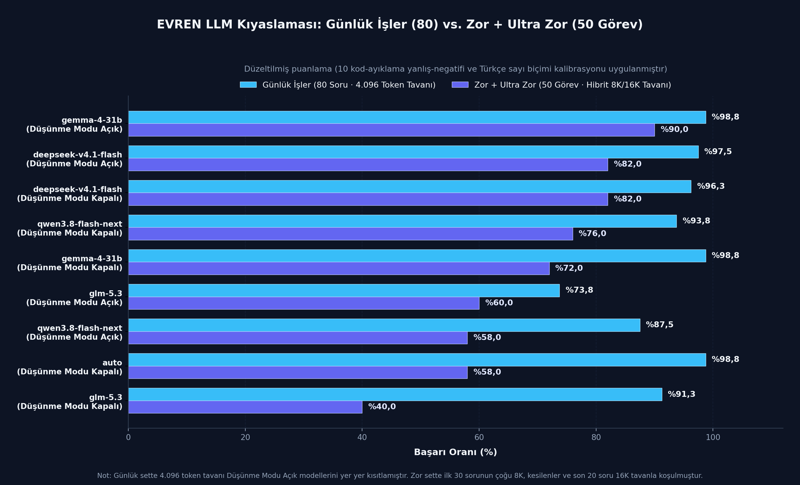
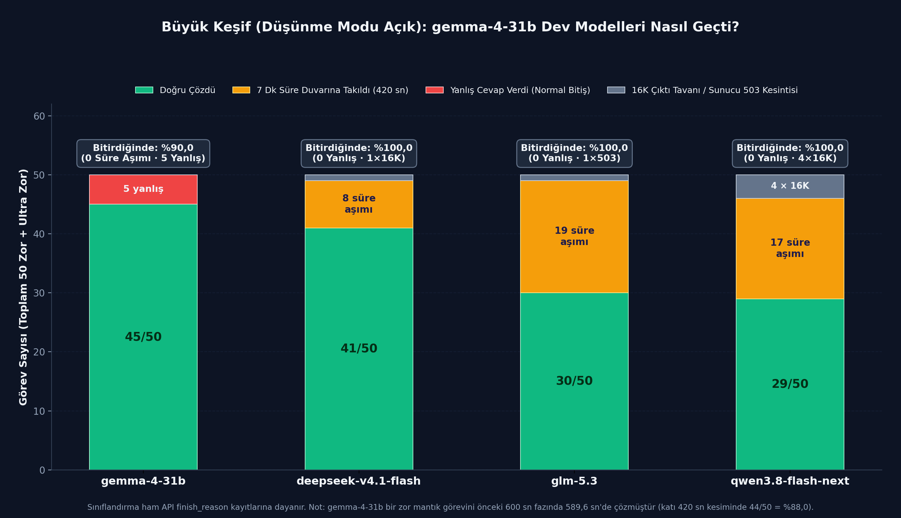
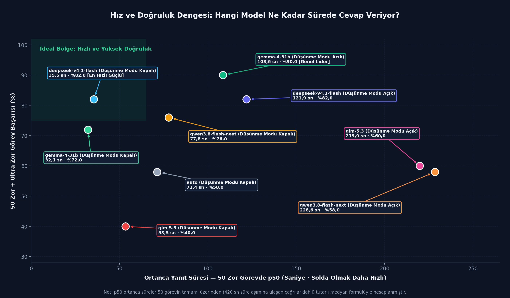
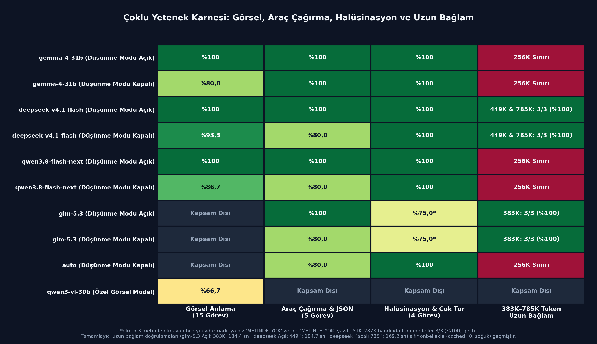
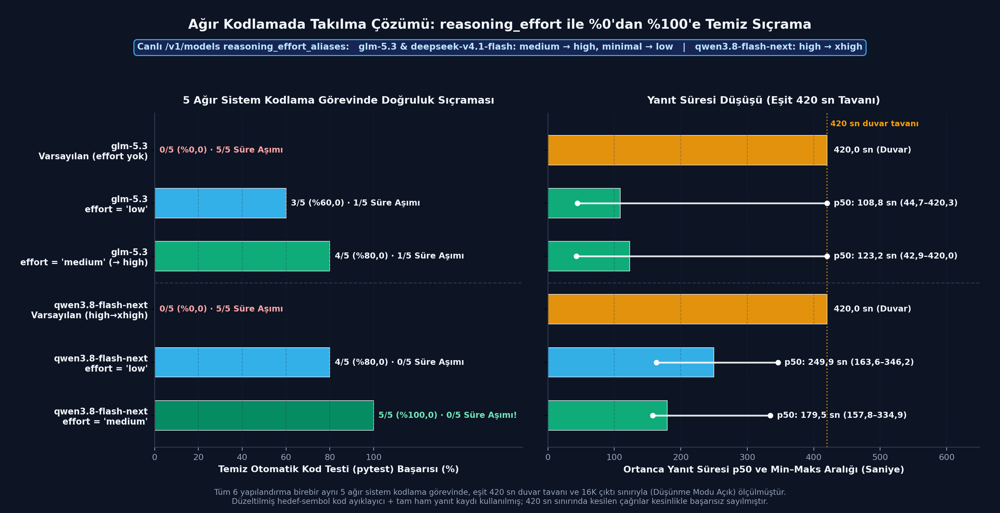

# EVREN LLM Benchmark: 1.727 Görevlik (2.270 Çağrılık) Açık Kaynak Kıyaslama

[](https://github.com/kenantabak/evren-llm-benchmark/actions/workflows/ci.yml)
[](LICENSE)
[](pyproject.toml)

**EVREN LLM API (`https://evren.ssyz.org.tr/llm-inference`)** üzerindeki `7` model ve otomatik yönlendirici (`auto`) için uçtan uca tekrarlanabilir kıyaslama paketi: günlük görevler (`80`), zor ve ultra zor kodlama/matematik/mantık (`50`), sentetik görsel anlama (`15`), özel belge OCR (`POST /v1/ocr`), araç çağırma ve sıkı JSON (`5`), `51K–785K` gerçek Türkçe token uzun bağlam, halüsinasyon/çok turlu bağlam takibi (`4`) ve eşit `420 sn` tavanlı `reasoning_effort` doğrulama deneyleri.

> **Toplam kapsam:** **`1.727` mantıksal test görevi** + **`543` otomatik ağ yeniden denemesi** = **`2.270` canlı HTTP çağrısı** (`temperature = 0.0`, sıralı tekli akış, akışlı SSE yanıt).

---

## Özet Bulgular (30 Saniyelik Rehber)

| İhtiyaç | Önerilen Model & Ayar | Doğrulanmış Sonuç |
| :--- | :--- | :--- |
| **Genel amaçlı, en dengeli lider** | **`gemma-4-31b`** *(Düşünme Modu Açık)* | Günlük **%98,8** (`79/80`), 50 zor görevde **%90,0** (`45/50`, `0` süre aşımı), görsel/araç/halüsinasyonda **%100**. |
| **En hızlı + güçlü günlük/kod asistanı** | **`deepseek-v4.1-flash`** *(Düşünme Modu Kapalı)* | Günlük `p50 = 15,6 sn`, zor `p50 = 35,5 sn` ile **%82,0** (`41/50`); `785K` bağlamda **%100 (`169,2 sn`, soğuk)**. |
| **Sıfır hata kritik mantık + dev dokümanlar (`256K+`)** | **`deepseek-v4.1-flash`** *(Düşünme Modu Açık)* | Bitirebildiği `41/41` zor görevde **%100 (`0` yanlış)**; `449K` (`184,7 sn`, soğuk) ve `785K` (`174,0 sn`) bağlamda `3/3`. |
| **Ağır sistem kodlamada `qwen3.8-flash-next` tam gücü** | **`qwen3.8-flash-next`** *(Açık + `reasoning_effort: "medium"`)* | Varsayılan `high -> xhigh` takılmasını kırıp `0/5 -> 5/5 (%100,0)`, **`0/5` süre aşımı** (`p50 = 179,5 sn`)! |
| **Ağır kodlamada `glm-5.3` tam gücü** | **`glm-5.3`** *(Açık + `reasoning_effort: "medium"` / `"low"`)* | Varsayılan `0/5` takılmasından `"medium"` (API `"high"`) ile **`4/5 (%80,0)`** (`p50 = 123,2 sn`), `"low"` ile **`3/5`** (`108,8 sn`). |
| **Saf belge/fatura/tablo metne dökme (hızlı OCR)** | **`deepseek-ocr-2`** veya **`dots-ocr`** *(`POST /v1/ocr`)* | İkisi de saf metin/tablo çıkarmada **`5/5`**: `deepseek-ocr-2` **`2,1 sn`** (temiz Markdown + Türkçe), `dots-ocr` **`5,3 sn`** (HTML `<table>`). |
| **Görsel anlama + hesaplama/yorumlama** | **`deepseek-v4.1-flash`**, **`qwen3.8-flash-next`**, **`gemma-4-31b`** *(Açık)* | Üçü de `15/15 (%100)`; özel görsel model `qwen3-vl-30b` `10/15 (%66,7)` (`16 sn` video için tercih edilmeli). |

---

## Temel Grafikler

### 1. Günlük İşler (`80` Soru) vs Zor + Ultra Zor (`50` Görev)


### 2. Büyük Keşif: 31B'lik `gemma-4-31b`, 763B'lik Devleri Nasıl Geçti?


### 3. Hız (`p50`) ve Doğruluk Dengesi


### 4. Çoklu Yetenek Karnesi: Görsel, OCR, Araç Çağırma, Uzun Bağlam, Halüsinasyon


### 5. Ağır Kodlamada Takılma Çözümü (`reasoning_effort` ile `%0 -> %100`)


---

## 9 Model × Mod Doğrulanmış Kıyaslama Tablosu

| Model | Mod | Günlük (`80`) | Günlük Hız (`p50`) | Zor + Ultra Zor (`50`) | Zor Hız (`p50`) | Bitirdiğinde Doğruluk |
| :--- | :--- | :---: | :---: | :---: | :---: | :---: |
| **`gemma-4-31b`** | Düşünme Modu Açık | **%98,8** (`79/80`) | `34,7 sn` | **%90,0** (`45/50`) | `108,6 sn` | %90,0 (`45/50` · `0` süre aşımı) |
| **`deepseek-v4.1-flash`** | Düşünme Modu Açık | %97,5 (`78/80`) | `20,2 sn` | **%82,0** (`41/50`) | `121,9 sn` | **%100,0** (`41/41` · `0` yanlış) |
| **`deepseek-v4.1-flash`** | Düşünme Modu Kapalı | %96,3 (`77/80`) | **`15,6 sn`** | **%82,0** (`41/50`) | **`35,5 sn`** | %85,4 (`41/48`) |
| **`qwen3.8-flash-next`** | Düşünme Modu Kapalı | %93,8 (`75/80`) | `20,5 sn` | %76,0 (`38/50`) | `77,8 sn` | %76,0 (`38/50`) |
| **`gemma-4-31b`** | Düşünme Modu Kapalı | **%98,8** (`79/80`) | `17,9 sn` | %72,0 (`36/50`) | **`32,1 sn`** | %72,0 (`36/50`) |
| **`glm-5.3`** | Düşünme Modu Açık | %73,8 (`59/80`) | `50,9 sn` | %60,0 (`30/50`) | `219,9 sn` | **%100,0** (`30/30` · `0` yanlış) |
| **`qwen3.8-flash-next`** | Düşünme Modu Açık | %87,5 (`70/80`) | `25,7 sn` | %58,0 (`29/50`) | `228,6 sn` | **%100,0** (`29/29` · `0` yanlış) |
| **`auto`** | Düşünme Modu Kapalı | **%98,8** (`79/80`) | `19,0 sn` | %58,0 (`29/50`) | `71,4 sn` | %61,7 (`29/47`) |
| **`glm-5.3`** | Düşünme Modu Kapalı | %91,3 (`73/80`) | `20,8 sn` | %40,0 (`20/50`) | `53,5 sn` | %44,4 (`20/45`) |

> Tüm detaylı kırılımlar, `finish_reason` dağılımları, prefix-cache ölçümleri ve modül bazlı skorlar [`data/summary_metrics.json`](data/summary_metrics.json) ve [`METHODOLOGY.md`](METHODOLOGY.md) içinde yer alır.

---

## Repo Mimarisi

```text
evren-llm-benchmark/
├── README.md                         # Teknik özet, grafikler ve hızlı başlangıç
├── METHODOLOGY.md                    # Sabit parametreler, SSE, extractor, OCR ve prefix-cache protokolü
├── data/
│   └── summary_metrics.json          # Tüm 9 model×mod ve alt modüllerin doğrulanmış metrikleri
├── assets/
│   ├── chart_01_genel_ve_zor_50.png
│   ├── chart_02_neden_gemma_gecti.png
│   ├── chart_03_hiz_ve_dogruluk.png
│   ├── chart_04_coklu_yetenek_karnesi.png
│   └── chart_05_effort_cozumu.png
├── src/evren_llm_bench/
│   ├── code_extractor.py             # Hedef-sembol kod ayıklayıcı + Türkçe sayı normalleştirme + pytest
│   ├── metrics.py                    # Tutarlı p50/p95, finish_reason sınıflandırıcı, cached_tokens
│   └── runner.py                     # EVREN_LLM_API_KEY tabanlı SSE chat & POST /v1/ocr istemcisi
├── tasks/
│   ├── full_80.py                    # 80 günlük görev (8 modül)
│   ├── hard_30.py                    # 30 zor görev (Python ile kendi kendini doğrulayan)
│   ├── ultra_hard_20.py              # 20 ultra zor ayrıştırıcı görev
│   ├── vision_15.py                  # 15 sentetik görsel görev + üretici
│   ├── final_suite.py                # Araç çağırma/JSON, 51K-785K Türkçe uzun bağlam, halüsinasyon
│   ├── patch23_effort_lc.py          # Eşit 420 sn tavanlı reasoning_effort + soğuk uzun bağlam
│   └── vision_assets/                # 15 sentetik yer-gerçeği (ground-truth) PNG test görseli
└── tests/
    └── test_benchmark_suite.py       # Otomatik birim ve bütünlük testleri (pytest)
```

---

## Kurulum ve Tekrar Çalıştırma

### 1. Kurulum ve Çevrimdışı Doğrulama Testleri
```bash
git clone https://github.com/kenantabak/evren-llm-benchmark.git
cd evren-llm-benchmark
python -m pip install -r requirements.txt
python -m pip install -e . --no-deps
python -m pytest -v
```

### 2. Canlı EVREN LLM API Üzerinde Çalıştırma
API anahtarınızı **yalnızca ortam değişkeni** üzerinden verin (asla koda veya repoya yazmayın):

```bash
export EVREN_LLM_BASE_URL="https://evren-llmapi.ssyz.org.tr/v1"
export EVREN_LLM_API_KEY="YOUR_EVREN_API_KEY"
# İsteğe bağlı ayrı Düşünme Modu Kapalı / Açık anahtarları:
# export EVREN_LLM_API_KEY_REASONING_OFF="YOUR_KEY_OFF"
# export EVREN_LLM_API_KEY_REASONING_ON="YOUR_KEY_ON"

# Örnek: 23 çağrılık temiz reasoning_effort + uzun bağlam doğrulama seti
python -m tasks.patch23_effort_lc

# Örnek: 20 görevlik ultra zor set
python -m tasks.ultra_hard_20
```

Python içinden `EvrenLLMRunner` kullanımı:
```python
from evren_llm_bench import EvrenLLMRunner

runner = EvrenLLMRunner()  # EVREN_LLM_API_KEY env var okur
res = runner.chat_stream(
    model="qwen3.8-flash-next",
    mode="reasoning_on",
    messages=[{"role": "user", "content": "Merhaba EVREN!"}],
    max_tokens=16384,
    wall_cap_s=420,
    extra_body={"reasoning_effort": "medium"},
)
print(res["finish_reason"], res["latency_s"], res["content"][:120])

ocr_res = runner.ocr("tasks/vision_assets/V05_tr_invoice.png", model="deepseek-ocr-2")
print(ocr_res["latency_s"], ocr_res["text"][:120])
```

---

## İlgili Platformlar ve Tam Çalışma Bağlantıları

Bu açık kaynak kod deposu, 4 platforma yayılan **EVREN LLM Kıyaslama** çalışmasının tekrarlanabilir kod ve doğrulama katmanıdır:

- **EVREN Forum — Kıyaslama Bulguları (`benchmarks`):** [31B'lik Model, 763B'lik Devleri Nasıl Geçti? (1.727 Görev / 2.270 Çağrı)](https://evren.ssyz.org.tr/forum/t/01a21c3d-5a01-7bf3-aacd-37b8cb1a3ebb)
- **EVREN Forum — Pratik Kullanım Rehberi (`guides`):** [EVREN LLM Karar Haritası ve 5 Altın İş Akışı Rehberi](https://evren.ssyz.org.tr/forum/t/01a21c3d-5ae5-7be2-8a4f-330b7ec887d9)
- **Hugging Face Ham Veri Seti (Parquet, `CC-BY-4.0`):** [kenantabak/evren-llm-benchmark-results](https://huggingface.co/datasets/kenantabak/evren-llm-benchmark-results) · [EVREN Flagship Spaces & Benchmarks Koleksiyonu](https://huggingface.co/collections/kenantabak/evren-flagship-spaces-and-benchmarks-6b056b2e42321ae4eaf72a70)
- **Dev.to Teknik Derinlemesine Makale (Seri 3 / Bölüm #12):** [31B vs 763B LLM Kıyaslaması: 1.727 Görevde finish_reason Telemetrisi & Gizli reasoning_effort](https://dev.to/kenantabak/31b-vs-763b-llm-kiyaslamasi-1727-gorevde-finishreason-telemetrisi-gizli-reasoningeffort-2g5a)
- **GitHub Kod & Metodoloji Deposu (MIT):** [kenantabak/evren-llm-benchmark](https://github.com/kenantabak/evren-llm-benchmark)

---

## Not ve Sorumluluk Reddi

Bu repodaki tüm doğruluk oranları, yanıt süreleri ve kullanım önerileri belirli bir test seti ve zaman diliminde (EVREN LLM API'nin ücretsiz *Test ve Entegrasyon Süreci*, 1 Aralık 2026 öncesi) gerçekleştirilen kendi deney ve gözlemlerimizin yorumudur; kesin kural veya garanti taşımaz. Testler `temperature = 0.0` ile tek koşu olarak yapılmış olup bazı uzmanlık modüllerindeki örneklem sayıları küçüktür (halüsinasyon/çok turlu takip `n = 4`, özel OCR, araç çağırma ve `reasoning_effort` kodlama `n = 5`, görsel anlama `n = 15`). Sunucu yoğunluğu, tekrarlayan metin önbelleği (*prefix cache*) durumu, model sürümleri ve yönlendirici ağırlıkları zamanla değişebileceğinden kritik üretim iş yüklerinizde kendi verilerinizle kısa bir doğrulama yapmanız önerilir.
